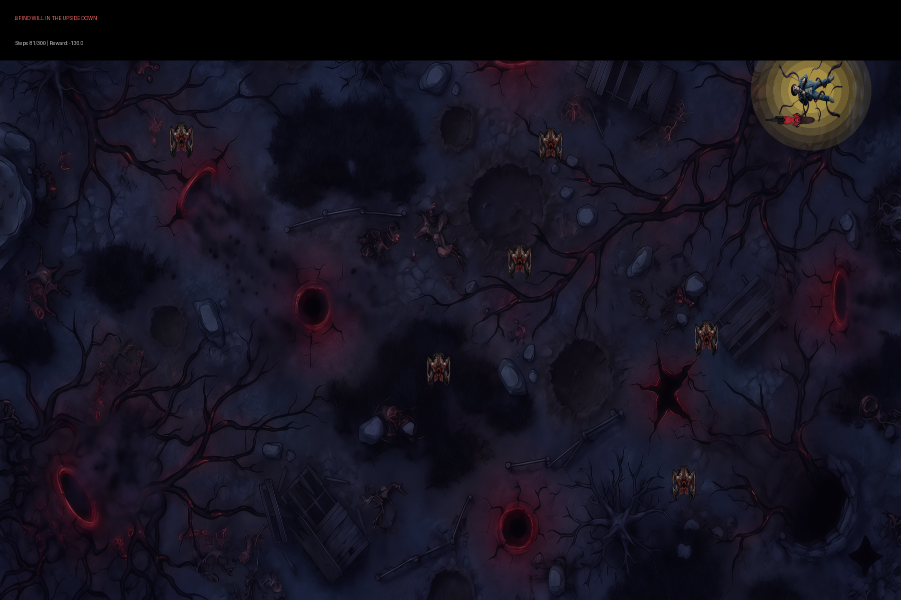
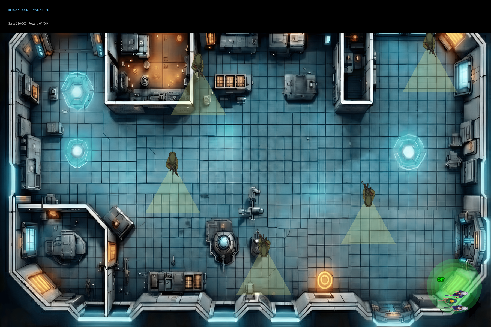
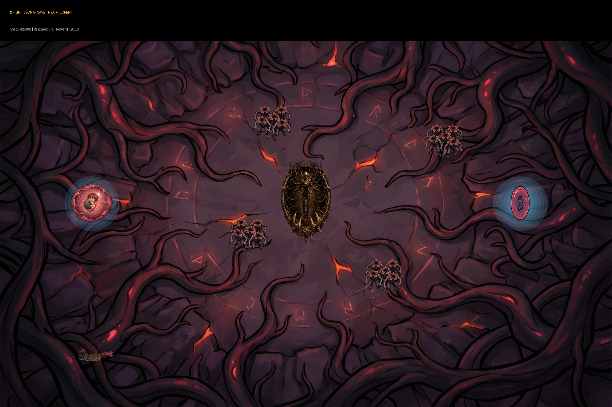

# Xodia @ Credenz '26 — Stranger Things Multi-Agent RL Competition

**Xodia** is the AI/RL game-bot event at **Credenz**, the PICT IEEE Student Branch's annual technical fest. The **Credenz 2026** edition was themed on *Stranger Things*. Participants trained **three separate Q-learning agents**, one for each of three "universes", and every universe had its own objective, reward function and adversaries. The organisers did not solve an RL problem here: they *designed* one, building the environments, the game engine, the submission template and a fair evaluation pipeline.

> Credenz '25 Xodia (Angry Birds, PPO) is in [`xodia-credenz-2025`](https://github.com/PICT-IEEE-Student-Branch/xodia-credenz-2025). All Credenz events are listed in [`credenz`](https://github.com/PICT-IEEE-Student-Branch/credenz).

| Find Will | Escape Room | Fight Vecna |
|---|---|---|
|  |  |  |

*Best-episode trajectories from the competition evaluation.*

---

## The three universes

### Universe 1: Find Will
**Mission:** Eleven must rescue Will from the Upside Down.

- 20×20 grid. Start (2, 2), goal: Will at (17, 12). **6 Demogorgons** on wandering patrol.
- **Observation (6):** `[agent_x, agent_y, will_x, will_y, nearest_demo_x, nearest_demo_y]`
- **Rewards:** +500 found Will (dist < 1.5) · −100 Demogorgon collision (dist < 1.8) · −0.1 × distance to Will · −0.5 per step
- **Max steps:** 300

### Universe 2: Escape Room
**Mission:** Escape Hawkins Lab while avoiding Russian guards.

- 20×20 grid. Start (2, 18), exit at (18.5, 2.5). **5 guards** on patrol routes.
- **Observation (6):** `[agent_x, agent_y, exit_x, exit_y, nearest_guard_x, nearest_guard_y]`
- **Rewards:**
  - +600 for reaching the exit (dist < 1.5)
  - Progressive shaping: if dist < 2.0, +(2.0 − d)·50; if dist < 5.0, +(5.0 − d)·10; otherwise −0.3·d
  - Guard "flashlight" detection (dist < 4.5): −100·(4.5 − d)/4.5, plus −150 if captured (dist < 1.5)
  - −0.8 per step, which is cancelled (+0.8) within 12 units of the exit
- **Max steps:** 300

### Universe 3: Fight Vecna
**Mission:** Rescue two children while avoiding Vecna and his projectiles.

- 20×20 grid. Start (10, 2), children at (3, 10) and (17, 10). **Vecna + Demogorgons + tracking projectiles**.
- **Observation (12):** `[agent_x, agent_y, child1_x, child1_y, child2_x, child2_y, vecna_x, vecna_y, child1_rescued, child2_rescued, projectile_x, projectile_y]`
- **Rewards:** +200 per child · +300 for both (win) · −200 too close to Vecna (dist < 2.5, instant death) · −150 hit by projectile (dist < 0.8, instant death) · −80 Demogorgon collision · −0.05 × distance to each unrescued child · −1.0 per step
- **Max steps:** 300

**Actions (all universes):** `0 = Right, 1 = Up, 2 = Left, 3 = Down`

---

## Repository structure

```
xodia-credenz-2026/
├── realm_engine.py          # Game engine: the 3 universes, physics, enemies, rewards, rendering (NumPy + Pillow)
├── submission_template.py   # What participants fill in: 3 discretize_* functions + 3 create_universe*_agent() functions
├── example_solution.py      # Organisers' reference solution (tabular Q-learning, all 3 universes)
├── competition_runner.py    # Trains + evaluates a submission, saves best-run renders, builds the leaderboard
├── assets/                  # Sprites and backgrounds (univ1/, univ2/, univ3/)
└── docs/best-runs/          # Best-episode renders shown above
```

## Quick start (participants)

```bash
pip install numpy pillow opencv-python

# 1. Implement the TODOs in submission_template.py (discretisation + epsilon-greedy + Q-update per universe)
# 2. Test it
python competition_runner.py submission_template.py --episodes 200 --runs 1
python competition_runner.py submission_template.py --episodes 200 --runs 1 --visualize   # live view (needs OpenCV)
```

**Scoring:** `Total = best(Universe 1) + best(Universe 2) + best(Universe 3)`, averaged over runs.

Submit **only your completed Python file** (for example `team_solution.py`).

## Running the contest (organisers)

```bash
# Put every team's file in submissions/, then:
python competition_runner.py --all submissions/ --episodes 1000 --runs 3   # each submission, 3 independent runs
python competition_runner.py --leaderboard                                 # rebuild leaderboard from xodia_results/
```

Per-run results go to `xodia_results/<submission>_run<k>_results.json`. Best-episode renders go to `xodia_results/final/`. Both are git-ignored.

Smoke test (verified): `python competition_runner.py example_solution.py --episodes 40 --runs 1` completes all three universes and writes the JSON and renders.

## Reusing this for a future Xodia

- Copy the structure, not the theme. Keep "engine + template + runner", and swap the universes, sprites and reward functions.
- Use several universes with separate agents. That rewards understanding the problem over tuning one agent.
- Run every submission several times (`--runs 3`) and average. Tabular Q-learning has high variance between seeds.
- Before you release the problem, run `example_solution.py` to make sure every universe can actually be solved within the step budget.

## Notes

- Original development repo: [`malharinamdar/credenz26-xodia`](https://github.com/malharinamdar/credenz26-xodia). Participant submissions and per-team results are **intentionally not included** here.
- In that repo, a May 2026 cleanup commit left `competition_runner.py` without its CLI dispatch: it parsed the arguments and exited. This org copy uses the complete runner from the actual competition (Feb 2026), which includes multi-run averaging and the leaderboard.

## Credits

Designed and built for Credenz '26 by Malhar Inamdar (PISB Xodia).
